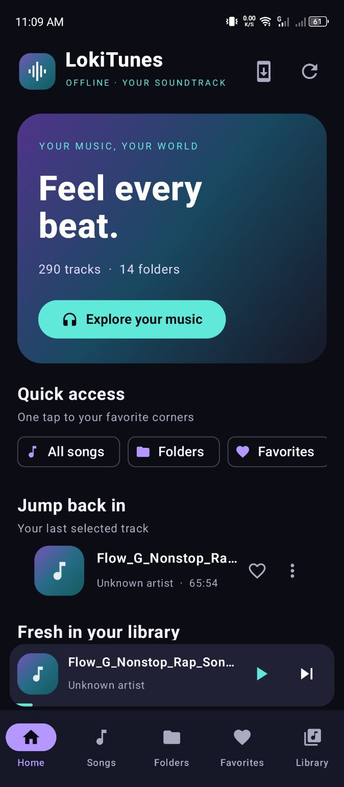
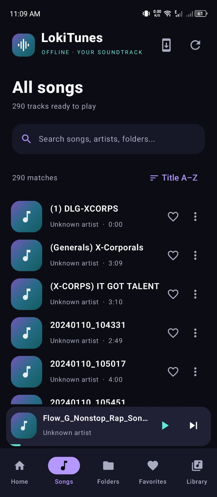
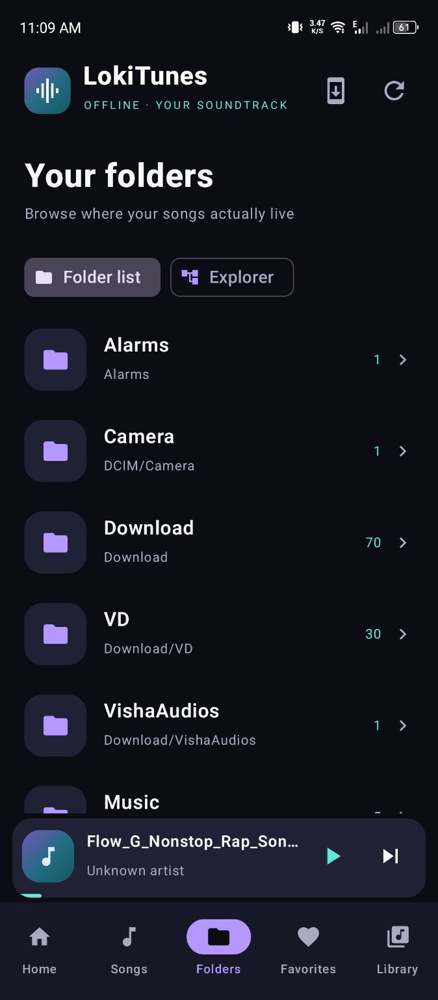
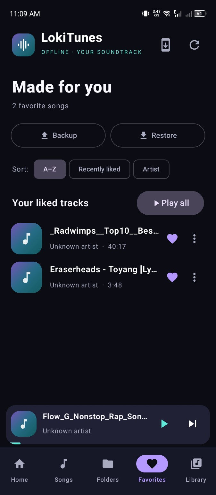
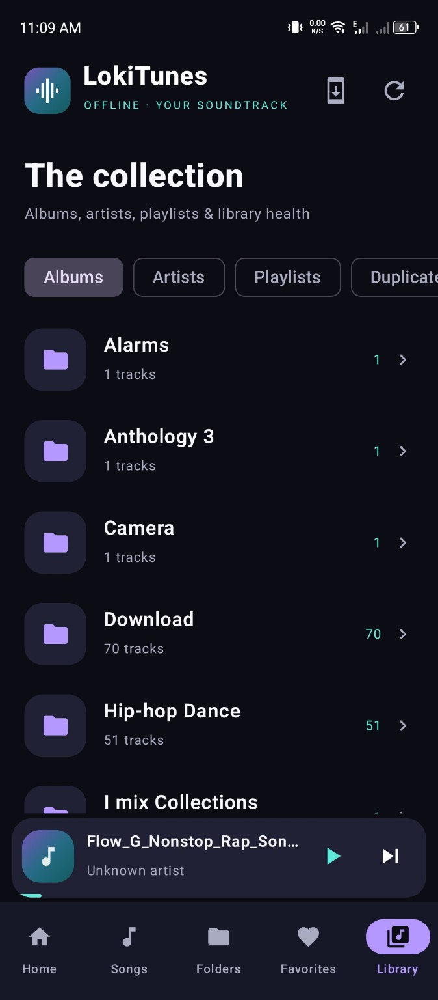
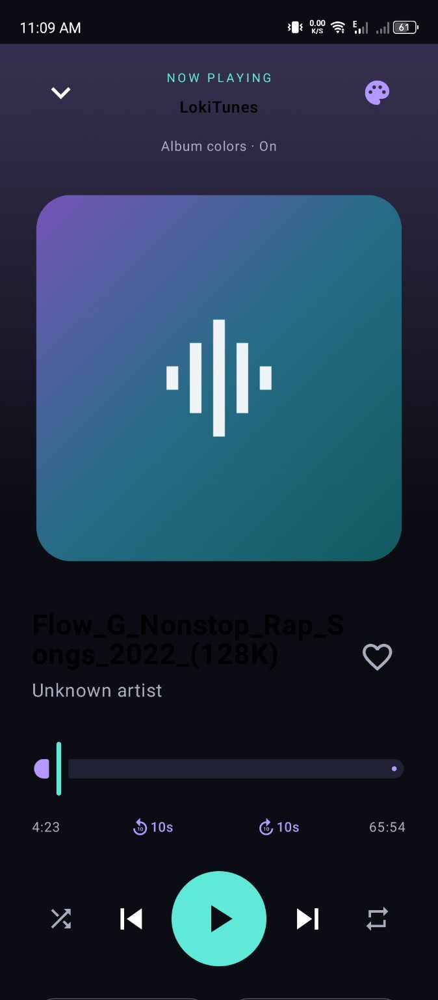
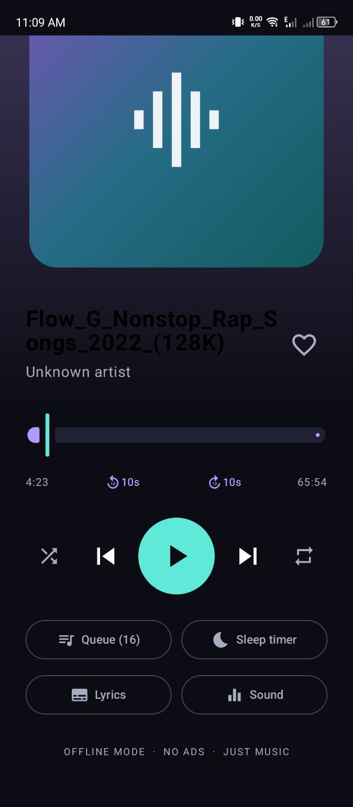
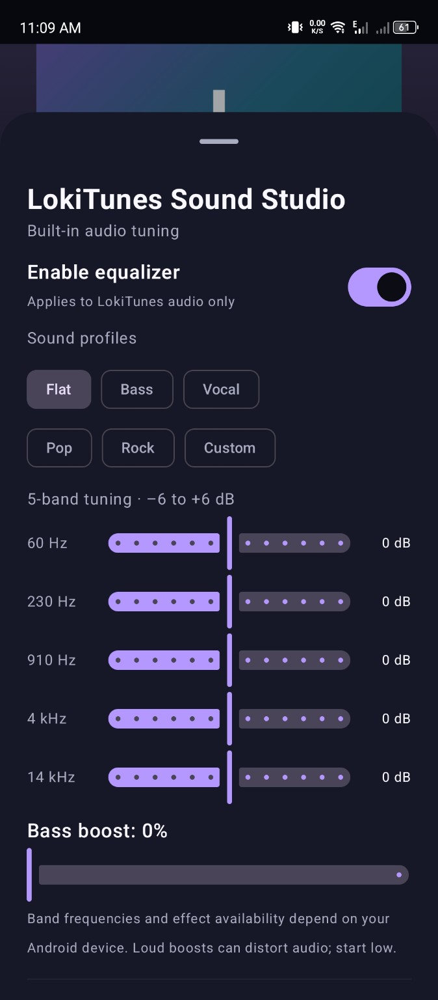
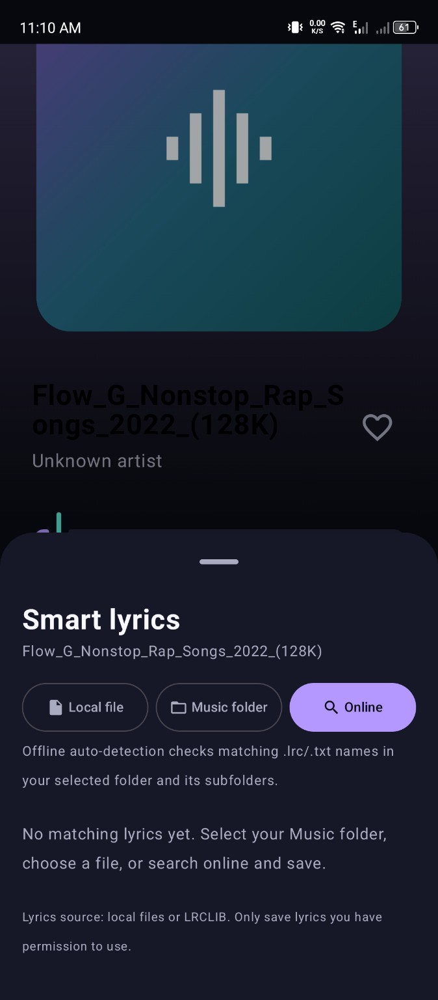

# 🎧 LokiTunes

### Your Music. Your Rules.

**A free, open-source, offline-first music player for Android.**

*Discover your music. Organize it your way. Enjoy every beat.*

**[⬇️ Download latest APK](https://github.com/LokiJ07/LokiTunes/releases/latest)** · **[📘 Installation guide](docs/INSTALLATION.md)** · **[🔒 Privacy](docs/PRIVACY.md)** · **[🐛 Report an issue](https://github.com/LokiJ07/LokiTunes/issues/new/choose)**

---

## ✨ Why LokiTunes?

LokiTunes puts **your own music library** first. It plays music already saved on your Android device, lets you browse real folders, and keeps Favorites and custom playlists locally. There is **no account, subscription, or advertising**.

The signature **Midnight Aurora** look pairs a near-black interface with purple and cyan accents. Album artwork can influence the Now Playing colors; tracks without artwork use a gradient fallback.

**Music playback works without internet.** Internet is used only for optional online lyrics and checking/downloading app updates. Update checks can occur automatically when the app starts; no music files are uploaded.

## 📸 Screenshots

*Captured from LokiTunes v1.0.0 running on an Android device. Music titles and library counts are examples from the test device.*

| Home | Songs | Folders |
|:---:|:---:|:---:|
|  |  |  |

| Favorites | Library | Now Playing |
|:---:|:---:|:---:|
|  |  |  |

| Playback controls | Sound Studio | Smart Lyrics |
|:---:|:---:|:---:|
|  |  |  |

## 🎵 Features

| Experience | What you get |
|:--|:--|
| **Offline listening** | Play indexed audio files stored on your Android device; no streaming account required. |
| **Library browsing** | Songs, albums, artists, folder list and folder explorer. |
| **Find your music** | Search and sort songs; inspect possible duplicate entries without deleting files. |
| **Make it yours** | Favorites, custom playlists, backup/restore for Favorites. |
| **Playback controls** | Mini-player, playback queue, play next, shuffle, repeat, seek, sleep timer. |
| **Background audio** | Media controls while using other apps, including supported lock-screen and Bluetooth controls. |
| **Smart Lyrics** | Open local `.lrc`/`.txt` files, auto-match accessible lyric folders, or search LRCLIB on demand and save results for offline use. |
| **Sound Studio** | Device-dependent equalizer presets, custom audio bands, bass boost, and playback speed controls. |
| **Color & design** | Midnight Aurora UI, album-art accent colors, and artwork-free gradient fallback. |
| **Signed updates** | Check GitHub Releases, download a signed APK and hand off to the Android installer with user approval. |

> **Availability varies:** Some audio effects depend on device support; some folders are restricted by Android storage rules. Online lyric availability depends on LRCLIB and applicable rights. See [FAQ](docs/FAQ.md) and [Known Issues](KNOWN_ISSUES.md).

## 📲 Download & install

1. You need **Android 8.0 (API 26) or later**.
2. Open the **[latest GitHub Release](https://github.com/LokiJ07/LokiTunes/releases/latest)**.
3. Under **Assets**, download the official **`LokiTunes-vX.Y.Z-release.apk`** file.
4. Open the APK and approve Android's installation prompt. You may need to enable **Install unknown apps** for the app that opened the APK.
5. Launch LokiTunes and grant the music-library permission when prompted.

**Use the signed APK from GitHub Releases, not a debug artifact from GitHub Actions.** Debug builds can have incompatible signing certificates. Read the [installation and update guide](docs/INSTALLATION.md) for full details.

## 🔄 Updates without losing your library

Installed from a **signed GitHub Release**? LokiTunes can detect a newer public release and guide you through downloading and installing it. The Android installer must still request your approval.

For normal install-over updates, the newer APK must use **the same signing certificate and package ID** and have a higher `versionCode`. **Do not uninstall** to update; doing so can delete local playlists, Favorites and saved lyrics.

## 🔒 Privacy by design

- **No account** and **no advertising or developer-operated analytics** in the v1.0.0 source.
- Your music files are accessed on device, not uploaded by LokiTunes.
- Favorites, playlists, preferences and saved lyrics are stored locally.
- The app **checks GitHub for updates** (including a startup check) and contacts **LRCLIB only when you request an online lyrics search**. As with normal HTTPS requests, those services receive technical connection information; lyric searches send the title and artist if available.
- Optional Favorites exports are files you explicitly save.

Read the complete **[Privacy Policy](docs/PRIVACY.md)**.

## ⚙️ Built with

**Kotlin · Jetpack Compose · Android Media3 / ExoPlayer · Android MediaStore · Android audio effects · GitHub Actions & Releases**

- **Package ID:** `com.lokij.lokitunes`
- **Minimum Android version:** 8.0 (API 26)
- **Source license:** [MIT](LICENSE)
- **Development:** [Contributing guide](CONTRIBUTING.md) · [Issue tracker](https://github.com/LokiJ07/LokiTunes/issues)

The app is independent software and is not affiliated with Spotify or any music streaming service.

## 🗺️ Roadmap & feedback

LokiTunes v1.0.0 is its first public milestone, not a promise that every Android phone has been tested. Feature requests and reproducible bugs are welcome via [GitHub Issues](https://github.com/LokiJ07/LokiTunes/issues).

Current priorities: accessibility polish, more device-compatibility tests, and stability improvements. For already-known caveats see [Known Issues](KNOWN_ISSUES.md).

## 📄 Project information

- [Installation & updates](docs/INSTALLATION.md)
- [Privacy Policy](docs/PRIVACY.md)
- [Frequently Asked Questions](docs/FAQ.md)
- [v1.0.0 release notes](docs/RELEASE_NOTES_v1.0.0.md)
- [Contributing](CONTRIBUTING.md)
- [Known Issues](KNOWN_ISSUES.md)
- [License](LICENSE)

---

**Made with 💜 by [LokiJ07](https://github.com/LokiJ07)**  
**LokiTunes — Your Music. Your Rules. 🎧**

